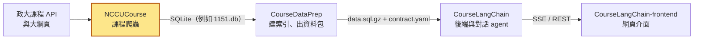

# NCCUCourse 文件

> 最後確認：2026-11-15，對照 `origin/main`（`53fa92af`，PR #3 合併後）。
> 文件與程式不一致時，以程式為準，並請更新本文件。

**課程資料爬蟲**：從政大的公開課程 API 與課程大綱頁，抓下一個學期的全部課程，存成 SQLite。
整個選課助理的課程資料都從這裡開始。

---

## 摘要

選課助理能查到什麼課、課綱寫了什麼，取決於這裡抓得完不完整、大綱解析得對不對。

| 項目 | 115-1 實測（commit 紀錄，2026-08） |
|---|---|
| 涵蓋率 | 2,925 門：教務處公布的 2,923 門全部抓到，另有 2 門外語能力檢定只在 API 上有 |
| 抓取方式 | 依學院、系所分類逐層查詢，再對照教務處公布的課程清單補抓漏掉的課 |
| 大綱 | 依大綱頁的段落標題自動建立欄位，學校新增段落時不必改程式 |
| 沒有大綱頁的課 | 72 門；爬取時就辨識出校方的佔位頁，不再當成抓取失敗重試 |

**與課程檢索的關係**：大綱的「課程目標、課程簡介、每週進度、評量方式、指定書目」這五個欄位，
在 CourseDataPrep 被組成字面比對（BM25）的文字，也被切塊轉成向量。**這裡漏抓一門課，檢索就永遠找不到它；
這裡把大綱段落放錯欄位，檢索就會用錯的內容比對。**

## 在系統中的位置



---

## 開發者指南

### 安裝與設定

```sh
uv sync
```

（根目錄 README 的 `pip install -r requirement.txt` 是舊寫法，`pyproject.toml` 與 `uv.lock` 才是準。）

學期設定在 [`config.yaml`](../config.yaml)，不在 `.env`：

| 區段 | 用途 |
|---|---|
| `target` | 要抓的學期（現為 115-1）；`--fast` 只抓這一學期 |
| `crawl.semesters` | 歷史學期清單（101-1 起），不加 `--fast` 時 `--course` 與 `--teacher` 會逐一抓 |
| `remain` | 選課餘額要抓的學期 |

`.env` 只放 iNCCU 帳密，**只有 `--teacher` 需要登入**。`.env` 不可 commit。

### 執行

```sh
# 只抓 config.yaml target 那一學期的課程（最常用，不需要登入）
OPENSSL_CONF=openssl.conf uv run python main.py --course --fast --db 1151.db
```

遇到 SSL 錯誤時要帶 `OPENSSL_CONF=openssl.conf`。

| 參數 | 資料來源 | 抓幾個學期 | 需要登入 |
|---|---|---|---|
| `--course` | 政大課程 API 與大綱頁 | `--fast` 時一學期，否則全部歷史學期 | 否 |
| `--teacher` | 政大 API 與教學評量系統 | `--fast` 時一學期 | **是** |
| `--rate` | 舊版課程評價頁 | 全部歷史學期（不受 `--fast` 影響） | 否 |
| `--result` | 本機 CSV 與 API | 設定檔指定的學期 | 否 |
| `--db` | 輸出的 SQLite 檔名 | — | — |

### 輸出

SQLite，主要的表：

| 表 | 內容 |
|---|---|
| `COURSE` | 一門課在一個分類下一列，主鍵 `(id, dp1, dp2, dp3)`；`id` 是 13 碼課號，**同一門課屬於多個分類時會有多列**。含課名、老師、時間、學分、語言、開課單位，以及大綱各段落 |
| `TEACHER` | 老師代號與姓名 |
| `RATE` | 歷年課程評價 |
| `RESULT` | 選課結果（人數上限、選上人數） |

大綱段落的欄位：七個已知段落沿用固定欄位名（`objective`、`syllabus`、`schedule`、`evaluation`、`textbook`、
`teaching_approach`、`ai_policy`）；學校之後新增的段落以 `detail_` 開頭自動建立欄位，欄位名會檢查只含小寫英數與底線。

### 主要檔案

| 檔案 | 內容 |
|---|---|
| `main.py` | 入口與命令列參數 |
| `config.py`、`config.yaml`、`constant.py` | 學期與常數 |
| `fetcher.py` | HTTP 請求（含重試與逾時） |
| `fetchDescription.py` | 大綱頁解析 |
| `courseList.py` | 讀教務處公布的課程清單（`data/course_list/`），補抓分類查詢漏掉的課 |
| `backfill_syllabus.py` | 補抓大綱失敗的課 |
| `DB.py` | SQLite 存取與欄位建立 |
| `User.py` | iNCCU 登入（`--teacher` 用） |
| `fetch_remain.py`、`fetchRate.py`、`fetchResult.py` | 餘額、評價、選課結果 |

### 交給下一步

把產出的 `.db` 交給 CourseDataPrep：`uv run python -m prep.release build --source <檔名>.db`。

### 已知問題

- [`SPECS.md`](../SPECS.md) 部分內容過時：學期清單已從 `main.py` 搬到 `config.yaml`，`--result` 的學期也改由設定檔決定；
  `COURSE` 的主鍵實際是 `(id, dp1, dp2, dp3)`（`DB.py`），不是 `id` 單獨一欄。
- 根目錄 README 仍寫 Python 3.9 與 pip，實際以 `pyproject.toml` 為準。
- 分類查詢在結構上會漏課（不屬於任何系所，或系所組合沒有列舉到），目前靠教務處課程清單補齊；
  學校改變清單格式時要注意。

## 相關文件

- [根目錄 README](../README.md)、[SPECS.md](../SPECS.md)
- [CourseDataPrep 文件](https://github.com/NCCU-AI-SYSTEM/CourseDataPrep/blob/main/docs/README.md)：爬下來的資料怎麼變成檢索資料
- [課程檢索（CourseLangChain/docs/RETRIEVAL.md）](https://github.com/NCCU-AI-SYSTEM/CourseLangChain/blob/main/docs/RETRIEVAL.md)
